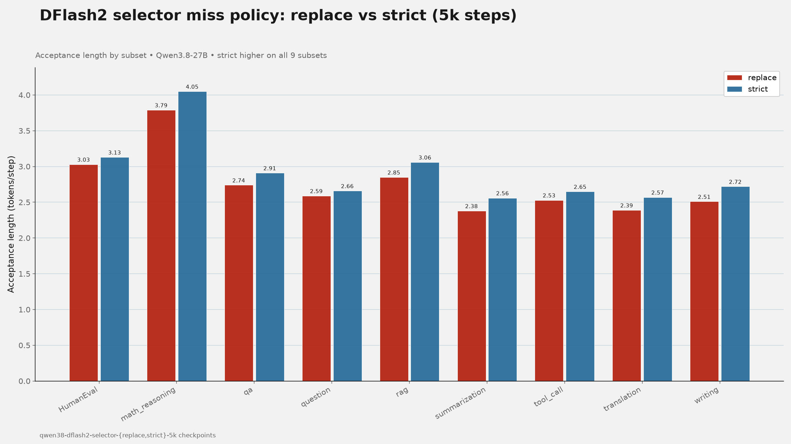
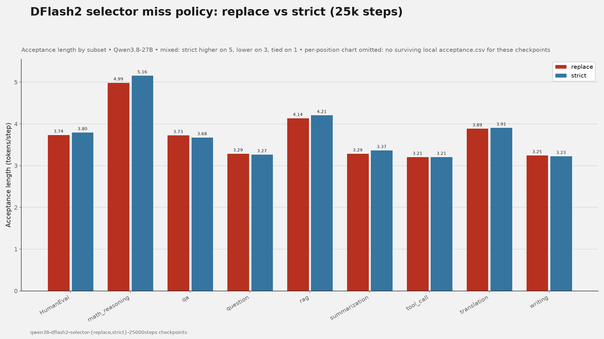
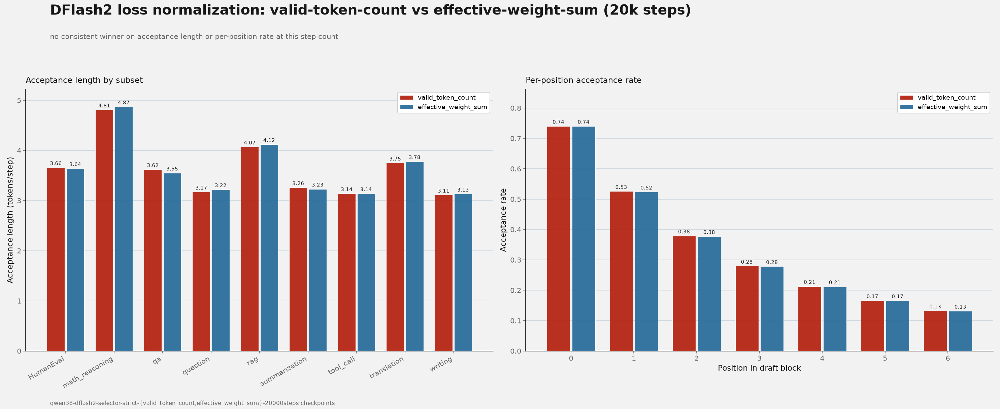
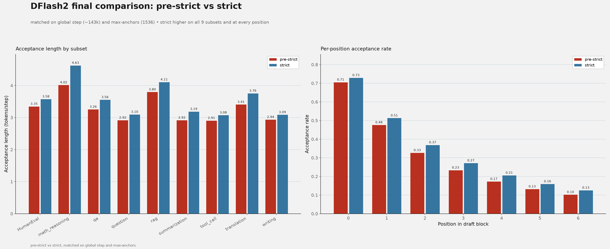

[{ .entry-avatar }](https://github.com/shubhra)
**[@shubhra](https://github.com/shubhra)** posted on **2026-10-28**

# DFlash2 selector and loss-normalization ablations on Qwen3.8-27B

## Summary

DFlash2's draft-model training had two open design questions worth investigating: how the selector should handle a missing gold token among its top-K candidates, and how the per-position selector loss should be normalized. This report covers ablations on both questions on Qwen3.8-27B, followed by a longer training run that incorporates the resulting change.

For the selector miss policy, `strict` improves acceptance length over `replace` on every subset at 5k training steps, which motivated adding `strict` as a selectable policy in [Speculators PR #1217](https://github.com/vllm-project/speculators/pull/1217). At 25k steps the difference narrows and becomes mixed. For loss normalization, `valid_token_count` and `effective_weight_sum` produce comparable acceptance lengths at 20k training steps, with no consistent winner across subsets. A final, step-matched comparison between a pre-strict checkpoint and its strict-policy counterpart shows `strict` ahead on every subset.

## Setup

- Target model: `Qwen/Qwen3.8-27B`.
- Draft model: DFlash2, trained with the `--selector-miss-policy` flag introduced in [Speculators PR #1217](https://github.com/vllm-project/speculators/pull/1217).
- Checkpoints evaluated:
  - replace, 5k steps: `qwen38-dflash2-selector-replace-5k-20261008_002640/checkpoints/0`
  - strict, 5k steps: `qwen38-dflash2-selector-strict-5k-20261008_111207/checkpoints/0`
  - replace, 25k steps: `qwen38-dflash2-selector-replace-25000steps-20261012_010849/checkpoints/0`
  - strict, 25k steps: `qwen38-dflash2-selector-strict-25000steps-20261009_151402/checkpoints/0`
  - strict, effective-weight-sum normalization, 20k steps: `qwen38-dflash2-selector-strict-effective_weight_sum-20000steps-20261016_155251/checkpoints/0`
  - strict, valid-token-count normalization, 20k steps: `qwen38-dflash2-selector-strict-valid_token_count-20000steps-20261019_011313/checkpoints/0`
  - final comparison, pre-strict: `nm-research/qwen3.8-27B-speculator.dflash2.updatedparams.epoch1_end` (Hugging Face Hub; global step 143,291, `--max-anchors 1536`)
  - final comparison, strict: `nm-research/qwen3.8-27B-speculator.dflash2.updatedparams.strict.ckpt0` (Hugging Face Hub; global step 143,349, `--max-anchors 1536`)
- Algorithm settings: block size 8, selector top-K 16.
- Training data: a prepared version of the open-perfectblend dataset mix.
- Training: `torchrun`, 4 GPUs per run, seed 42, 1 epoch capped at the step counts above for the selector-policy and normalization ablations. The final-comparison checkpoints are matched on global step and `max-anchors`, differing only in the `--selector-miss-policy` flag, confirmed from each checkpoint's `train_command.txt`.
- Evaluation: `RedHatAI/speculator_benchmarks` via `evaluate.py ... throughput`.
- Hardware: 8x NVIDIA H200 node (4 GPUs used per training run).

## Reproduction

The strict selector miss policy is implemented in [Speculators PR #1217](https://github.com/vllm-project/speculators/pull/1217).

## Results

### Strict versus replace selector policy

When the verifier's target token is absent from the selector's top-K candidates, `replace` inserts the target into the last candidate slot and trains the selector on that position. `strict` leaves the candidate set unchanged and masks the selector loss for that position; the unary loss remains active.

#### 5k training steps

Acceptance length by subset (tokens per round):

| Subset | Replace | Strict | Strict − replace |
|---|---:|---:|---:|
| HumanEval | 3.03 | 3.13 | +0.10 |
| math_reasoning | 3.79 | 4.05 | +0.26 |
| qa | 2.74 | 2.91 | +0.17 |
| question | 2.59 | 2.66 | +0.07 |
| rag | 2.85 | 3.06 | +0.21 |
| summarization | 2.38 | 2.56 | +0.18 |
| tool_call | 2.53 | 2.65 | +0.12 |
| translation | 2.39 | 2.57 | +0.18 |
| writing | 2.51 | 2.72 | +0.21 |

Strict is higher on all nine subsets at 5k steps, which prompted adding `strict` as a selectable policy in [Speculators PR #1217](https://github.com/vllm-project/speculators/pull/1217). Mean acceptance length is approximately 2.76 for replace and 2.92 for strict.

#### 25k training steps

| Subset | Replace | Strict | Strict − replace |
|---|---:|---:|---:|
| HumanEval | 3.74 | 3.80 | +0.06 |
| math_reasoning | 4.99 | 5.16 | +0.17 |
| qa | 3.73 | 3.68 | −0.05 |
| question | 3.29 | 3.27 | −0.02 |
| rag | 4.14 | 4.21 | +0.07 |
| summarization | 3.29 | 3.37 | +0.08 |
| tool_call | 3.21 | 3.21 | 0.00 |
| translation | 3.89 | 3.91 | +0.02 |
| writing | 3.25 | 3.23 | −0.02 |

At 25k steps the results are mixed: strict is higher on five subsets, lower on three, and tied on one. Mean acceptance length is approximately 3.73 for replace and 3.76 for strict. Per-position acceptance rates are nearly identical between the two policies.

The training-time validation metric `val/unary_candidate_recall_at_16_epoch` (how often the gold token appears in the unary head's top-16 candidates) favors `strict` at both step counts: 0.687 → 0.713 at 5k, and 0.780 → 0.790 at 25k. This metric is more consistent than the downstream acceptance-length comparison above.

### Valid-token-count versus effective-weight-sum normalization

The two loss reductions differ in their denominator:

- `valid_token_count`: divides the weighted loss by the number of valid tokens, using `loss_mask.sum()`.
- `effective_weight_sum`: rescales the loss by `valid.sum() / (valid * decay_weight).sum()`, so the effective denominator is the sum of valid per-position decay weights.

Acceptance length by subset (tokens per round):

#### 20k training steps

| Subset | Valid-token count | Effective-weight sum |
|---|---:|---:|
| HumanEval | 3.66 | 3.64 |
| math_reasoning | 4.81 | 4.87 |
| qa | 3.62 | 3.55 |
| question | 3.17 | 3.22 |
| rag | 4.07 | 4.12 |
| summarization | 3.26 | 3.23 |
| tool_call | 3.14 | 3.14 |
| translation | 3.75 | 3.78 |
| writing | 3.11 | 3.13 |
| Mean | 3.62 | 3.63 |

Mean acceptance length is very similar between the two normalization schemes, and per-position acceptance rates nearly overlap. Subset-level differences are small and mixed in direction, showing no consistent winner between the two normalization methods at this step count.

### Final comparison: pre-strict versus strict

This compares a pre-strict checkpoint against its strict-policy counterpart from the same longer training recipe, matched on global training step (143,291 vs. 143,349) and `max-anchors` (1536 for both); the two checkpoints differ only in the `--selector-miss-policy` flag.

| Subset | Pre-strict | Strict | Strict − pre-strict |
|---|---:|---:|---:|
| HumanEval | 3.35 | 3.58 | +0.24 |
| math_reasoning | 4.02 | 4.63 | +0.61 |
| qa | 3.26 | 3.56 | +0.30 |
| question | 2.92 | 3.10 | +0.18 |
| rag | 3.80 | 4.11 | +0.31 |
| summarization | 2.92 | 3.19 | +0.28 |
| tool_call | 2.91 | 3.08 | +0.17 |
| translation | 3.41 | 3.76 | +0.35 |
| writing | 2.94 | 3.09 | +0.15 |
| Mean | 3.28 | 3.57 | +0.29 |

Strict is higher on every subset, a smaller but still consistent margin compared to the step-capped 5k comparison above.

## Observations

- The `strict` selector miss policy improved acceptance length over `replace` on every subset at 5k training steps, motivating its addition as a selectable training option; at 25k training steps the difference narrows and becomes mixed.
- `val/unary_candidate_recall_at_16_epoch` consistently favors `strict` over `replace` at both 5k and 25k training steps, even where downstream acceptance length does not.
- `valid_token_count` and `effective_weight_sum` loss normalization produce comparable acceptance lengths at 20k training steps, with no consistent subset-level winner.
- In a final comparison matched on global training step and `max-anchors`, `strict` is higher than pre-strict on every subset, consistent with the 5k-step result.
- Results above do not include run-to-run variance or confidence intervals; subset-level differences should be interpreted descriptively rather than as statistically significant.

## Next steps

We are training a new DFlash2 drafter that incorporates the `strict` selector miss policy along with further changes, aimed at producing a more usable drafter overall. Results from that effort will be reported separately.

## References

- [DFlash2 strict selector miss policy, Speculators PR #1217](https://github.com/vllm-project/speculators/pull/1217)
